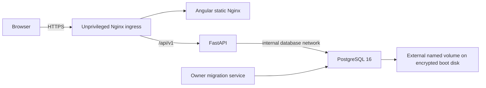

> Active path: owner manual provisioning, Docker Compose, GHCR and encrypted SFTP/Restic. Dedicated Terraform is inactive. See [final audit](PHASE_5_17_FINAL_VALIDATION.md).

# Dedicated Demo 3 architecture and baseline

Preparation only, 2026-11-02. No application algorithms, authentication code or migrations changed.

One Ubuntu 24.04 VPS, one IPv4, 30 GB encrypted boot disk, explicit UTC time. Only ingress publishes 80/443. DB has an internal network and no public mapping. Docker published ports can bypass UFW: UpCloud filtering and absence of backend/database port mappings are essential.

## Repository baseline

- `backend/app/main.py`: `app.main:app`, API prefix `/api/v1`, SQLAlchemy/psycopg PostgreSQL. Alembic revisions: `0001_initial`, `0002_authentication`, `0003_api_tokens`.
- Python project requires >=3.13; Docker uses a maintained digest-pinned Python3.13 Alpine base. Existing production requirements pin direct packages; requirements.production.lock.txt fixes all43 application package versions without upgrades. Binary wheels install in the build target; complete unused pip/ensurepip installers are absent from the immutable runtime. UID/GID1000 preserves writable-volume compatibility. Backend/UI base images are digest-pinned. Upgrade locks/digests deliberately with audit/build/tests; release images also use immutable digests.
- `ui/`: Angular standalone components/CoreUI, route guards, cookie/CSRF interceptor. Production environment enables auth and same-origin `/api/v1`. `npm ci` uses committed lock; output is `dist/ui/browser`.
- Existing Kaggle CSV sales ingestion, catalog, dashboard/historical analytics, forecasts, evaluations/backtesting, predictions, recommendations, reports and optional assistant remain intact. AI and public demo are disabled in this dedicated stack by default.
- Actual routes include `/api/v1/ingestion/sales`, `/api/v1/forecasts`, `/api/v1/forecasts/runs`, `/api/v1/forecasts/{run_id}/predictions`, `/api/v1/forecasts/{run_id}/evaluation`, `/api/v1/recommendations`; auth uses `/api/v1/auth/login`, `/me` and `/logout` beneath `/api/v1/auth`.
- `/api/v1/health` checks process; `/api/v1/ready` checks DB SELECT 1. Release controller separately compares Alembic heads.
- Existing JSON logging/safe structured errors are reused. Container logs rotate 10 MB x 3, host journal capped 200 MB. Do not enable secret/request-body logging or print Compose configuration.
- Existing backend/unit/integration, Angular, Playwright, Docker CI remain active; dedicated Terraform provisioning is historical/inactive. See [acceptance](ACCEPTANCE.md) for current-run results.

## Deployment changes and blockers

Existing `infrastructure/terraform`, `compose.production.yml`, `deploy/ops` and workflows target a shared portfolio/Caddy host. The active dedicated path uses manual provisioning, compose.prod.yml, deploy/single and validation/publication/deployment workflows. Dedicated infra/terraform is historical/inactive. Dockerfiles are reused; frontend Nginx adds short-lived asset caching/index revalidation. Production Angular build disables critical-CSS inlining because its inline loader script would violate the Nginx self-only script CSP; full stylesheet loading remains external.

Approve exact manual plan/capacity/tier, off-server SFTP backup destination and costs, reviewer protection, fixed-egress transport, domain and runtime secrets before live work. Public Swagger is disabled by existing production policy. No public login/backup operation is claimed before live acceptance.
